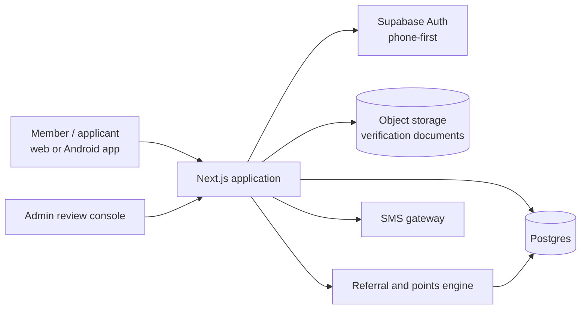
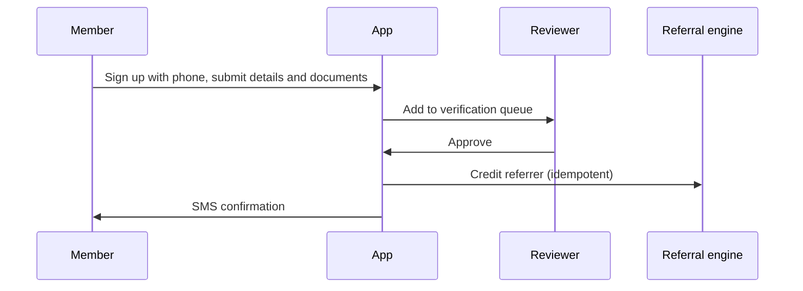

# Surokkha Health Services: Referral and Membership Platform

> **Architecture case study.** Source code is private and owned by the client. This repository contains original documentation only: no client code, data, credentials or assets.

## Problem

A health services provider needed to onboard members and applicants, verify identity, track referrals and rewards, and keep members informed, for users who may not have an email address and often use Android phones.

## Solution

A Next.js platform with a guided onboarding and verification flow, a referral and points engine, SMS-based communication, and an Android app built from the same codebase with Capacitor.

## Architecture

## Key flow

## Modules

- **Onboarding**: applicant sign-up, profile completion, nominee details
- **Verification**: document upload, review, approve or return
- **Referral engine**: referral links, attribution, points
- **Messaging**: SMS notices and replies
- **Admin**: review queues, member management

## Tech stack

- Next.js 15, React 19, TypeScript
- Tailwind CSS
- Supabase (Postgres, Auth)
- S3-compatible object storage for documents (signed requests)
- Capacitor for the Android app
- SMS gateway integration

## Key design decisions

1. Email-optional sign-up: identity is anchored on phone number so the platform fits how its users actually communicate.
2. Identity verification (KYC) is a staged workflow with review and approval, not a single form.
3. Referral and points logic is a separate engine with its own tests, including concurrency tests, so rewards cannot be double-counted.
4. One codebase serves web and Android via Capacitor, avoiding two parallel apps.
5. Behaviour is protected by targeted scripted tests for each critical flow (onboarding, approval, nominee, messaging).

---

Designed and delivered by [Adil Ahmed](https://adilahmed.info) at [Start Daily xyz Limited](https://startdaily.xyz), Dhaka.
